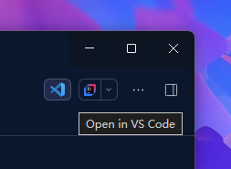

[中文](README.md) | **English**

# dsh-open-with-vscode

> A DeepSeek Harness plugin that fixes the broken "Open in VS Code" flow: adds a button **left of** the built-in "Open In..." control in the session header, opening the current session's workspace directory in VS Code with one click.



## Why this plugin

The DSH desktop host starts with `ELECTRON_RUN_AS_NODE=1` (the desktop shell spawns the core host in Electron's Node mode). The built-in `open-in-app` builds child environments with `{ ...scrubbedParentEnv(), ...options.env }`, but `scrubbedParentEnv()` only filters `/KEY|PASSWORD|SECRET|TOKEN/i` and the `DSH_*` prefix — it does **not** remove `ELECTRON_RUN_AS_NODE`:

- VS Code (also an Electron app) inherits that variable, treats itself as a Node interpreter, tries to `require` the directory argument as a module, and exits with code 1 almost immediately
- The route answers `HTTP 502 {"code":"launch-failed"}` — the button does nothing
- Reported in deepseek-harness discussion [#8049](https://github.com/deepseek-ai/deepseek-harness/discussions/8049); still reproducible on V0.2.1-rc.3

This plugin does **not** modify the built-in `open-in-app`. It provides its own route and button that sidestep the bug.

## Features

- Adds a VS Code icon button **left of** the built-in "Open In..." in the session header (`order: -20`, before the built-in `-10`)
- Opens the **current session's workspace directory** in VS Code; follows session switches automatically
- Launch environment scrubs `ELECTRON_RUN_AS_NODE` case-insensitively ("clear the inherited first, then merge explicit", matching the community fix)
- Never touches the host's own environment: commands executed through the Windows Job runner (pwsh / grep, etc.) are unaffected

## Installation

### Via dsh-market (listed)

Listed in the [awesome-dsh-plugin](https://github.com/awesome-dsh-plugin/awesome-dsh-plugin) catalog — install with one click by searching **open-in-vscode** (or `faxble/dsh-open-with-vscode`) in the plugin market.

### Via npm

```bash
dsh plugin --profile <profile> add dsh-open-with-vscode
# or
npm install dsh-open-with-vscode
# or
pnpm add dsh-open-with-vscode
```

### Manual install (local development)

Install this repository directory from the DSH plugin manager page, and make sure the profile patch inserts:

```yaml
- insert:
    - id: open-in-vscode
      name: dsh-open-with-vscode
      config: {}
```

## Usage

1. Open any session (its working directory becomes the target)
2. Click the VS Code icon button at the top-right of the session header, left of "Open In..."
3. VS Code opens that workspace directory

The button only appears when the session has a working directory; on launch failure an error notice is shown under the button.

The tooltip follows the DSH language automatically — in an English UI it reads "Open in VS Code".

## How it works

- **Host side**: provides an independent `POST /open-in-vscode` route (same auth fence and request validation as the built-in), locates `Code.exe` (LOCALAPPDATA / Program Files / App Paths registry / PATH fallback), and launches it `detached` with a scrubbed environment that excludes `ELECTRON_RUN_AS_NODE`
- **Client side**: registers the `conversation.session.header.utilities` slot (`order: -20`), reads the session `cwd`, and calls that route on click

## Built-in "Open In..." comparison

| | Built-in open-in-app | This plugin |
|---|---|---|
| Opens VS Code | ❌ 502 (`ELECTRON_RUN_AS_NODE` leak) | ✅ works |
| Button position | session header | left of "Open In..." |
| Target | pick an app manually | fixed VS Code + current workspace |
| Modifies built-in? | — | no, independent route |

## Compatibility

- Windows (VS Code desktop `Code.exe`)
- DSH desktop V0.2.1-rc.3 (and versions carrying the `ELECTRON_RUN_AS_NODE` leak)
- macOS / Linux not yet adapted (executable discovery is Windows-only)

## Development

```bash
pnpm install
# syntax check after edits
node --check index.js && node --check client.js
```

## License

[MIT](LICENSE)
