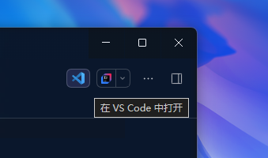

**中文** | [English](README.en.md)

<p align="center">
  
</p>

# dsh-open-in-vscode

> 修复 DeepSeek Harness 桌面端「用 VS Code 打开」失效问题的插件：在会话头部「打开方式」**左侧**新增一个按钮，一键在 VS Code 中打开当前会话的工作区目录。



## 为什么需要它

DSH 桌面宿主以 `ELECTRON_RUN_AS_NODE=1` 启动（桌面壳以 Electron 的 Node 模式派生核心宿主）。内置 `open-in-app` 启动子进程时用 `{ ...scrubbedParentEnv(), ...options.env }` 构造环境，而 `scrubbedParentEnv()` 只过滤 `/KEY|PASSWORD|SECRET|TOKEN/i` 与 `DSH_*` 前缀，**并不剔除 `ELECTRON_RUN_AS_NODE`**：

- VS Code（同为 Electron）继承该变量后把自己当成 Node 解释器，把目录参数当成模块 `require`，随即以退出码 1 结束
- 路由返回 `HTTP 502 {"code":"launch-failed"}`，按钮毫无反应
- 该问题已在 deepseek-harness 讨论 [#8049](https://github.com/deepseek-ai/deepseek-harness/discussions/8049) 反馈，V0.2.1-rc.3 仍复现

本插件**不修改内置 open-in-app**，而是提供独立的路由与按钮，绕开该 BUG。

## 功能

- 在会话头部「打开方式」**左侧**新增 VS Code 图标按钮（`order: -20`，位于内置 `-10` 之前）
- 点击后在 VS Code 中打开**当前会话的工作区目录**，随会话切换自动跟随
- 启动环境按大小写不敏感剔除 `ELECTRON_RUN_AS_NODE`（"先清继承、后合显式"，与社区修法一致）
- 不影响宿主自身环境：经 Windows Job runner 执行的命令（pwsh / grep 等）不受干扰

## 安装

### 通过 dsh-market（待上架）

等待 dsh-market 上架后，在插件市场中搜索 **open-in-vscode** 一键安装即可。

### 手动安装（抢先体验 / 本地开发）

在 DSH 插件管理页安装本仓库目录（或发布到 npm 后作为依赖安装），并确保 profile 的 patch 中插入：

```yaml
- insert:
    - id: open-in-vscode
      name: dsh-open-in-vscode
      config: {}
```

## 使用

1. 打开任意会话（其工作目录即为目标目录）
2. 点击会话头部右上角、位于「打开方式」左侧的 VS Code 图标按钮
3. VS Code 随即打开该工作区目录

按钮仅在会话存在工作目录时显示；启动失败会在按钮下方给出错误提示。

## 工作原理

- **Host 端**：提供独立的 `POST /open-in-vscode` 路由（带与内置一致的认证围栏与请求校验），定位 `Code.exe`（LOCALAPPDATA / Program Files / App Paths 注册表 / PATH 兜底），用清洗过、剔除 `ELECTRON_RUN_AS_NODE` 的环境 `detached` 启动
- **Client 端**：注册 `conversation.session.header.utilities` 槽位（`order: -20`），读取会话 `cwd`，点击后请求上述路由

## 与内置「打开方式」对比

| | 内置 open-in-app | 本插件 |
|---|---|---|
| VS Code 能否打开 | ❌ 502（`ELECTRON_RUN_AS_NODE` 泄漏） | ✅ 正常打开 |
| 按钮位置 | 会话头部 | 「打开方式」左侧 |
| 目标 | 需手动选择应用 | 固定 VS Code + 当前工作区 |
| 是否修改内置实现 | — | 否，独立路由 |

## 兼容性

- Windows（VS Code 桌面版 `Code.exe`）
- DSH 桌面端 V0.2.1-rc.3（及携带 `ELECTRON_RUN_AS_NODE` 泄漏的版本）
- macOS / Linux 暂未适配（可执行文件定位仅实现 Windows 路径）

## 开发

```bash
pnpm install
# 修改后检查语法
node --check index.js && node --check client.js
```

## License

[MIT](LICENSE)
